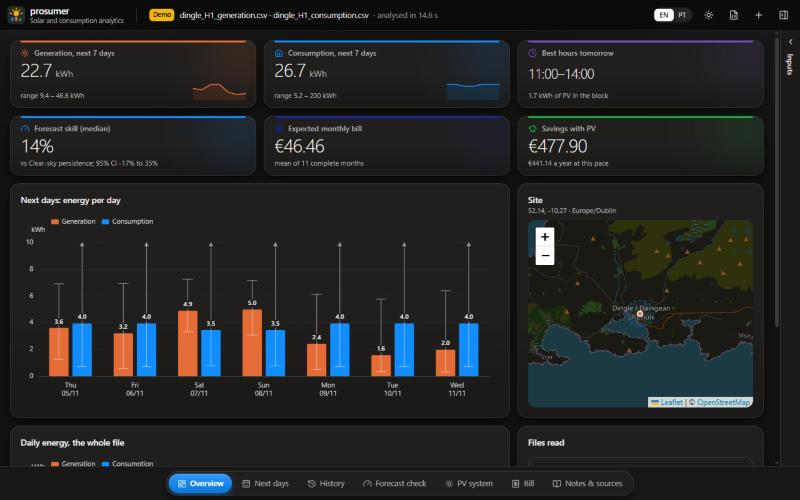
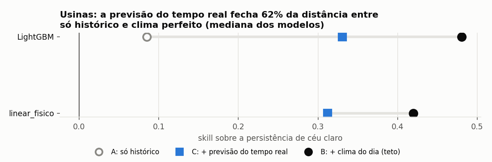

# prosumer

[](https://github.com/JoaoCarlos134/prosumer/actions/workflows/ci.yml)
[](LICENSE)


Day-ahead forecasting of energy prosumers' generation and consumption (PV plants, houses with PV), from
meter data to a complete, honest analysis. It is the basis of João Carlos Jachenski Junior's undergraduate
thesis (TCC), whose app is a thin layer over `prosumer.analyze`, and grew out of an Edge AI R&D project.



*The app (`webapp/`, a thin layer over the library) on its demo: house H1 of the public Dingle dataset (CC0).*

What makes it different from a forecasting toolkit: every default was decided by a benchmark of 57 models
on real plants and houses (`experimentos/testes_previsao/`), with a pilot and a gate before anything entered
the library, and the library re-does that benchmark's forecasts exactly (checked model by model). It never
picks "the best model" for you (the benchmark showed that choice is unstable); the output is the median of
the forecasts, scored against a fair reference, at several resolutions, with notes in plain language.

<p align="center"></p>

*One result of the benchmark, on the two PV plants: the real day-ahead weather forecast (blue) closes 75% of
the gap between history only (open circle) and perfect weather of the day (black) for the median model.
Skill is over clear-sky persistence. Like the rest of the benchmark, its labels are in Portuguese; the write-up is
`experimentos/testes_previsao/LEIA-ME.md`.*

**Status: 0.8.0 (2026-11-25); next 0.6.4 (server reruns) and 0.8.1** (see [Versions and roadmap](#versions-and-roadmap)). CPU
only by design: the best model of every benchmark test runs on a CPU.

## Install

```bash
uv pip install -e ".[lightgbm,net]"          # core + LightGBM + downloads behind TLS-inspecting proxies
uv pip install -e ".[chronos]"               # optional: Chronos-2 (each foundation model is its own extra)
uv pip install -e ".[fronius]"               # optional: read Fronius .xlsx exports
```

Python 3.11+. The core needs numpy, pandas, pyarrow, scipy and pandera only.

## One call: `analyze`

```python
from prosumer import analyze, data

houses = data.dingle_houses("consumption", houses=[1, 2, 3])  # real, public (CC0), downloaded once
report = analyze(houses, test_days=28)
print(report.to_markdown())
```

The report has: data quality (coverage, gaps, series ending apart), a day-ahead forecast check on the last
`test_days` (naive forecasts and their median as the output, skill against the benchmark's reference with a
day-bootstrap 95% CI, nRMSE, bias, R²), the same at several resolutions (hour, day/night, evening peak,
day), the data sources and licences, plain-language notes and the list of what is not available yet.
`report.to_dict()` is JSON-ready, for the app.

Your own data: `io.fronius.read_solarweb(["2024.xlsx", "2025.xlsx"], tz="America/Sao_Paulo", site=site)`
reads the inverter's 5-minute export into hourly kWh (one series per inverter); `io.meter.read_table(...)`
reads any CSV/Excel table of a meter (interval energy, a cumulative counter or average power, `;` and decimal
comma included). Whether Fronius stamps mark the start or the end of each 5 minutes is not documented: run
`analyze` with a site and look at the clock sections.

Add models and weather as you have them:

```python
from prosumer import EnergySeries, analyze
from prosumer.forecast import LightGBM, LightGBMQuantile
from prosumer.io import open_meteo

pv = EnergySeries.from_dataframe(df, unit="kWh", quantity="generation", tz="America/Sao_Paulo", freq="h")
site = (-24.83, -53.65)  # rounded: the coordinates are sent to Open-Meteo
raw = open_meteo.fetch_previous_runs(*site, start="2024-03-07", end="2026-05-31", tz="America/Sao_Paulo")
weather = open_meteo.wide(raw)  # one column per weather model, plus their mean and spread
ghi = [c for c in weather.columns if c.startswith("ghi_") and c != "ghi_spread"]

report = analyze(
    pv,
    site=site,  # clear-sky reference, sun hours, clock checked against the sun
    weather=weather,  # regime C (the real day-ahead forecast) and the clock against the clouds
    models=[
        LightGBM(),  # history only: regime A, enters the median
        LightGBM(ghi, name="LightGBM-weather"),  # several weather models at once (pilot F2(a): best in C)
        LightGBMQuantile(),  # bands: coverage, CRPS, and a conformal recalibration
    ],
)
```

- `issue_hour=12` checks a forecast issued at noon for the rest of the day (pilot F2(d): the evening peak of
  consumption issued at noon beats the one issued at midnight).
- Foundation models: `forecast.Chronos2()`, `forecast.TiRex2()`, `forecast.Toto2()`, `forecast.FlowState()`
  (zero-shot, Apache-2.0, CPU; Chronos-2, TiRex-2 and FlowState also give bands). Each `ModelCard` says its
  licence, device and whether it sends data anywhere. FlowState (9 M parameters, extra `ttm`) needs
  granite-tsfm, which pins scikit-learn < 1.8.

Add what the household pays, and the report gets a bill section (`Report.economics`: the monthly bill, by
tariff block for time of use, the totals, the expected monthly bill over the complete months and, with PV, the
savings against no PV):

```python
from prosumer import economics
from prosumer.economics import brazil

tou = economics.Tariff(
    prices={"peak": 0.45, "off_peak": 0.20},
    weekday={h: "peak" if 17 <= h < 21 else "off_peak" for h in range(24)},
    weekend=dict.fromkeys(range(24), "off_peak"),
    export_price=0.08,
)
report = analyze(pv, site=site, economics=economics.Plan(tou, scheme="net_billing"), consumption=load)

# Brazil: a distributor's tariffs from ANEEL's open data (ODbL), the taxes as read on the bill
book = brazil.TariffBook.from_aneel("COPEL-DIS", icms=0.19, pis_cofins=0.0925, fio_b_years=[2026])
report = analyze(load, economics=brazil.Setup(book=book, gd="GD II"), generation=pv)
```

For the coming days, `economics.windows_by_cost(pricing, generation=outlook)` ranks the hours of each forecast
day for a flexible load by expected cost (the tariff of each month, the PV surplus, the day's confidence label).

Or use the benchmark's protocol directly, to test a model of your own:

```python
from prosumer import DayAhead

task = DayAhead(series, test_start="2020-10-01", refit_days=31)  # rolling origin, causal gap filling
for window in task.windows():
    ...  # forecast window.timestamps from window.history (and window.future_covariates)
```

## Modules

| Module | What it does |
|---|---|
| `analysis` | `analyze(series) -> Report`, the app's single call (quality, clock, diagnostics, forecast check, bands, weather, bill with `economics=`) |
| `contracts` | `EnergySeries`: validated long frame (`unique_id`, `ds`, `y`, `valid`), units, time zone, step |
| `protocol` | `DayAhead`, `folds`, `standardize_by_training`: the benchmark's day-ahead task, without leakage |
| `metrics` | skill and its CI, Diebold–Mariano, `ranking`, `ties_with_best`, metrics by resolution, band scores |
| `forecast` | `Naive`, `LightGBM`, `LightGBMQuantile`, `EmpiricalQuantiles`, `Chronos2`, `TiRex2`, `Toto2`, `FlowState`; `rolling_forecast` |
| `postprocessing` | `conformal_quantiles` (causal band recalibration), `correct_bias` (consumption) |
| `physics` | sun position, clear sky, plane-of-array irradiance, orientation fit (numpy only) |
| `quality` | the clock of a PV series checked against the sun (`clock_offset`) and the clouds (`clock_offset_weather`) |
| `outlook` | `forecast_ahead`: the next 1-35 days, hourly and per day (generation: effective power and roof learnt from the clear days x the weather forecast, trusted less as the lead grows, then the season; consumption: the recent weeks' profile), with a confidence label per day; `best_windows` for heavy loads |
| `diagnostics` | from the energy alone: clear days, roof orientation, clear-day performance index and its steps (cleanings, faults) over time; `analyze(site=..., kwp=...)` |
| `io` | Fronius Solar.web exports (`fronius.read_solarweb`), any meter or station table (`meter.read_table`: interval, cumulative counter or power), Open-Meteo forecasts (archive of day-ahead runs and the live forecast up to 16 days, several models), `geocode` (address to coordinates, time zone, rounding), NASA POWER hourly weather, ANEEL open data (homologated tariffs, bandeiras, tariff components; ODbL) |
| `embedded` | a fitted Ridge, forest or LightGBM with its preprocessing and the day-ahead features, or the benchmark's SparseTSF / CycleNet (numpy arrays, `from_torch` without importing torch, causal gap fill), as one C header for an ESP32 (`to_c`, `footprint`, `block_totals`) |
| `economics` | tariffs as data (flat, time-of-use blocks for weekdays and weekends/holidays, export price, fixed charge); the monthly `bill` under net metering, net billing or self-consumption (hourly netting); `cheapest_windows` ranks the hours of the forecast days for a flexible load by price and sun. For the app: a `Pricing` says how a household pays (`Plan` = tariff + export scheme; `brazil.Setup` = an ANEEL tariff book + connection + GD class), used by `analyze(economics=...)` and by `windows_by_cost` (the cheapest windows of an `Outlook`, month by month). `economics.brazil`: tarifa cheia with ICMS and PIS/COFINS "por dentro", bandeiras, custo de disponibilidade, tarifa branca postos and holidays (with generation: per-posto netting and the TE ratio between postos, REN 1.000 art. 655-G), Lei 14.300/2022 (GD I until 2045, GD II Fio B ramp, 60-month credits), each rule cited to the law or ANEEL resolution |
| `provenance` | source and licence of every input, carried to the report |
| `data` | the real Dingle houses (CC0) and synthetic series for tests |

Not written yet: a model measured on a real device (1.0.0 below), soiling vs shading and string faults (they need
5-minute or DC data); in economics, COSIP read from a bill, grupo A and the tax reform (LC 214/2025).

## What the benchmark found (the defaults come from here)

- The weather input matters about ten times more than the model: on the plants the best skill goes from
  +0.14 (history only) to +0.37 (real day-ahead forecast) to +0.51 (the day's measured weather, a ceiling).
- Zero-shot foundation models lead with history only; a one-feature linear model on the weather is close to
  everything else once weather is in.
- Choosing the best model on the previous fold makes things worse; the median of all is a robust output.
- Bands: raw quantiles are calibrated in 7 of 11 tests; a causal conformal recalibration brings it to 10 of 11.
- Bias correction lifts consumption only for a median of ~40 models; for small medians it lowers the skill,
  so `analyze` reports it as a row, not as the output.

Details, numbers and every pilot: `experimentos/testes_previsao/LEIA-ME.md` and
`docs/projeto/PILOTOS_F1_F2.md` (in Portuguese).

## Versions and roadmap

One numbering for everything: the library, the app, the benchmark and the research runs. `MAJOR.MINOR.PATCH`:
the further left the number, the bigger the change.

- **MAJOR:** 1.0.0 is the thesis delivered: a person who does not program runs the whole analysis in the app, and
  the library is on PyPI.
- **MINOR:** a new capability (a module, an app feature), or a research result that changes a default.
- **PATCH:** fixes, reviews, docs, and research runs that leave every default as it was.

Anything that can change a number is a pilot whose gate is committed before the run (pass and fail are both
recorded in `docs/projeto/PILOTOS_F1_F2.md`). The library's changes, item by item, are in
[the changelog](docs/library/changelog.md). Versions before 0.1.0, and from 0.2.0 to 0.6.2, were numbered on
2026-11-25; git tags exist only for `v0.1.0`.

### Done

| Version | Date | What |
|---|---|---|
| 0.0.1 | 2026-10-05 | Benchmark v1: next-day hourly forecast issued at midnight, one train/test cut; references, zero-shot foundation models, trained networks; history only (regime A) and the day's measured weather (B, a ceiling) |
| 0.0.2 | 2026-10-06 | Benchmark v2: rolling origin (plants 5 folds, houses 3), every model retrained per fold, the real day-ahead weather forecast (regime C), Diebold–Mariano with Holm; a leak in the houses' consumption fixed |
| 0.0.3 | 2026-10-09 to 11 | 57 models, 260 result rows; every pending model studied and piloted before dropping (Lag-Llama and TimeGrad out, CycleNet and Mamba in). First pilots: 6 weather models in LightGBM, +0.373 and 1st of 24 (pass); causal conformal bands (pass); BuildingsBench (fail) |
| 0.1.0 | 2026-10-12 | **Library first release** (tag `v0.1.0`): the benchmark's protocol and metrics, physics, clock check, readers, forecasters, conformal bands, `analyze` in one call; it reproduces the benchmark model by model |
| 0.2.0 | 2026-10-12 to 15 | Diagnostics from the energy alone (roof, clear-day performance, steps; pilot 4 of 5); `outlook`, the next 1-35 days (pilot: generation leads 1-7 and consumption 1-14 pass); `embedded`, models as C headers for a microcontroller |
| 0.3.0 | 2026-10-13 to 17 | `economics` and `economics.brazil` (ANEEL open data, bandeiras, tarifa branca with PV, Lei 14.300). Pilot against real bills: fails, about 21 % under the bill with compensation (needs detailed bills) |
| 0.3.1 | 2026-10-16 to 19 | Any brand, any meter: reader of unknown layouts, counters read as counters, PVDAQ, real Fronius exports; every constant chosen on our sites becomes an argument with its origin declared; MPPT-channel pilot fails |
| 0.4.0 | 2026-10-19 to 21 | `app.run`, the app's backend in one call with strict JSON; English and Portuguese for every note; checks on what a person types; ~10 s down to ~4 s on seven years of data |
| 0.5.0 | 2026-10-23 to 28 | The site (`webapp/`: FastAPI and React, report-style pages, animations) and a standalone Windows program |
| 0.6.0 | 2026-11-04 | Public: AGPL-3.0-only; the plant series removed from the whole history and the repository recreated |
| 0.6.1 | 2026-11-16 to 18 | `outlook.look_back`, the last days beside the next ones; product review of the app and its fixes (plain-words overview, unknown roof asks for tilt and direction, inputs pane, page tags); learning-with-use replay on the two plants (fails there, not conclusive for a new site: the defaults were fitted on these plants); public datasets found; the compute-server queue written |
| 0.6.2 | 2026-11-18 to 23 | **Server results** (every gate written first). **Pass:** an untouched test period (06-11/2026) keeps the median and the ranking; 3 seeds reproduce the ties; a per-site range catches 79-82 % of days for an 80 % promise (the current range catches 64-69 %, and at 7 days ahead only 50 %); Chronos-2 fine-tuning wins 3 of 4 cases; range scores for every model. **Weak pass:** the mean of the 6 weather models wins 18 of 23 models on uncorrected p, but only 5 of 23 under Holm. **Fail:** foundation models with weather lose to the physical chain by 0.07-0.13; houses' PV in regime B changes rank with the season; the roof and clock checks on US systems; the weather-to-kWh conversion on BR-PVGen. **Broken:** plant positions, days 8-15, Time-LLM |
| 0.6.3 | 2026-11-25 | The server round closed on this machine. The four broken scripts fixed. Plant positions from the data's own curves: the run now completes and **fails** its gate (0 of 3 systems within 0.5 degrees; panel plane and position trade off), so BR-PVGen stays blocked. Days 8-15 re-measured on 7.5 months of daily runs: **day 8 now has skill** at both plants (+0.19 and +0.14, gate passed), days 9-10 do not. The server's checks written into the library's validation page (median and ranking out of sample, houses' PV changes rank with the season, fine-tuning an option not taken, foundation models with weather below the physical chain) |
| 0.7.0 | 2026-11-25 | **An honest daily range per site**: `outlook.site_range` and `forecast_ahead(past=...)` recalibrate each lead day's range on the site's own last 60 days of errors once 30 exist (79-82% of days inside an 80% range on the untouched period, against 64-69%); every generation outlook now says its default range is too narrow. Not in the app yet: it stores no forecasts (0.10.0) |
| 0.8.0 | 2026-11-25 | **The weather counts on day 8**: `trust` gains day 8 (0.69, "low" confidence); each plant's weight held on the other plant and on a later period (pilot P2-b). Checked and **not taken**: a richer sky model (Perez, 3.9% better plane irradiance where 5% was needed) and a panel temperature factor (better on 1 of 4 US systems), on PVDAQ systems with known planes. The ensemble test's gate written ahead of its data |

### Planned

| Version | What | Waiting on |
|---|---|---|
| 0.6.4 | The server's GPU reruns of the scripts fixed in 0.6.3: Time-LLM with LLaMA-7B and its no-LLM ablation; Crossformer and Mamba in the seed and season runs (`experimentos/testes_previsao/vm/FILA.md`) | a turn on the compute server |
| 0.8.1 | **Diagnostics outside Paraná.** First check the pilot's time zones (the Paraná control also failed the clock, and one US system is off by 11 h); then the clock with daylight saving time, with a test; then the tilt overestimated on low roofs (5 of 6 systems) | — |
| 0.9.0 | **A better generation forecast**, each item a pilot: ensemble forecasts for days 4-15 (their mean as the forecast, their spread as a range that is narrow on settled days and wide on uncertain ones; gate P3 already written); a trained model over the 6 weather forecasts for days 1-7 (so far +0.02 and +0.004, not significant); the mean of the 6 weather models as published regime C, after checking it on the untouched period; shading learnt by sun position; trust per climate and the Paraná constants checked elsewhere (PVDAQ's residential fleet, Ausgrid for consumption) | ensembles collected daily since 2026-11-19, testable from ~2027-02 (90 nights); trust per climate needs a public PV set with coordinates (estimating positions from the data failed in 0.6.3) |
| 0.10.0 | **Learning with use and the long view.** A local database (measurements, every issued forecast, per-site parameters, events the person marks); per-site trust and bias only where a site that did not choose the defaults shows a gain; days 9-15 as a weekly total with a range and the chance of a sunny day; the app stores what it forecast, so `site_range` (0.7.0) recalibrates every lead day | 0.7.0 and 0.9.0 |
| 0.10.1 | Site polish: the overview's range whiskers and the flattened hourly band become a percentile band; the demo served at once, with real progress for uploads; a preview image for shared links; a phone-width check | — |
| 1.0.0 | **The thesis.** A person who does not program completes the analysis end to end; the library on PyPI; the published benchmark (v2 or the 3-seed v3); a model measured on real hardware (Raspberry Pi 5, ESP32); the thesis written | the employer's and the university's IP rules (Lei 9.609 art. 4) before PyPI; the author's choice on v3 |
| 1.x | Connect to the inverter's cloud instead of an export; alerts; read the bill from a PDF or photo; what-if (tarifa branca, a battery, more panels: a pilot first, since a wrong answer is wrong money advice); a PDF report; Home Assistant; a hosted beta (needs Open-Meteo's commercial plan, offers its source under the AGPL); the library as a hosted API | each one the author's decision |

Blocked, not scheduled: the bill with compensation (needs detailed bills); TimeGPT (paid API that sends the data;
houses only); BR-PVGen per-climate trust (positions first); publishing the plant series (needs the data owner's
written permission).

### Old labels

The project's Portuguese docs use the labels below; each one now maps to a version.

| Old label | Version |
|---|---|
| E1-E3 (thesis plan: rename, version 0.1, check against the benchmark) | 0.1.0 |
| E4 (diagnosis, embedded) | 0.2.0; on a real device: 1.0.0 |
| E5 (hardware), E7 (writing), "App" gate | 1.0.0 |
| E6 (economics, docs, licence, publication) | 0.3.0 and 0.6.0 |
| F0 (decisions) | 0.6.0 (licence); the rest is in "Blocked" |
| F1, F2, A (closing the benchmark, improvement pilots, pending models) | 0.0.3; F2(b), the roof from the data: 0.2.0 |
| V0-V9, V11, V11-b, C1-C10, G1-G7 (server queue and its lanes) | done: 0.6.1 and 0.6.2; fixes and CPU reruns: 0.6.3; GPU reruns: 0.6.4 |
| V10 (re-aggregating Curitiba) | not planned (decided 2026-10-12 not to redo; the 1-h offset is declared) |
| P1-P6 (prediction priorities) | P2 (day 8) and P4 (conversion): 0.8.0; the rest 0.9.0; P5 blocked |
| P7 (the rest of the server batch) | 0.6.2 |
| Product review items 4-8 | 0.6.1 |
| Product review items 1-3, and the preview image of item 7 | 0.10.1 |
| Product review item 9 (long-use showcase, local only) | 0.6.1 |
| "Priority 2" items 1-2 (beyond a week, local database) | 0.10.0 |

## Data

The 20 houses are the public CC0 dataset of Khadem et al. (2024), "Comprehensive Dataset on Electrical Load
Profiles for Energy Community in Ireland", Scientific Data, doi:10.1038/s41597-024-03454-2 — cite it when
you use `data.dingle_houses`. Open-Meteo data are CC BY 4.0, but its free API is for non-commercial use only.

**The two PV plants' series are not in this repository.** They came from third parties and are not cleared
for publication, so they were removed from the whole history. The benchmark's scripts and its aggregate
results (metrics, rankings, figures) for the plants stay, so the method can be read; the tests that
recompute plant numbers skip without the data. Plants are named by city, and coordinates are rounded to
~1 km.

| Folder | What it is |
|---|---|
| `src/prosumer/` | the library |
| `tests/` | its tests, including exact parity with the benchmark's published numbers |
| `docs/proposta/` | thesis proposal, library feasibility study, plan |
| `docs/projeto/` | state of the analyses, pilots, plans for papers A and B |
| `docs/literatura/` | Edge AI review, references, survey of 127 models |
| `experimentos/testes_previsao/` | the day-ahead forecasting benchmark: scripts, hourly data, environments, results |
| `legado/` | the project's original code (reference only: the raw data are private) |

The package was called `prossumidor` until 2026-10-09. To pick up the work with Claude Code, start with
`CLAUDE.md`.

## License

[GNU AGPL-3.0-only](LICENSE). If you need other terms (for example, to ship it inside a closed product),
contact the author. Third-party data and model weights keep their own licences; `Report.provenance` lists
them for every analysis.
