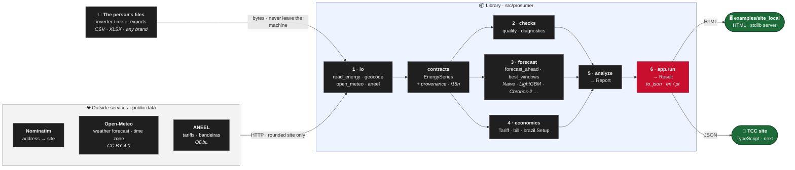
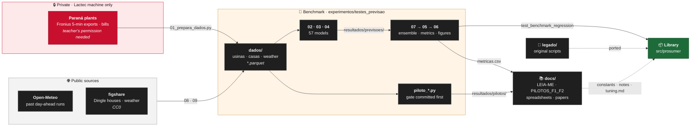

# Map of the repository

What every part of `prosumer` is, what its main functions do, where each piece of data comes from and where
it goes. Written on 2026-10-21. The rules and the current state are in `CLAUDE.md`; this file is the
structure. Update it when a module, a data source or a pipeline step is added.

## 1. The whole in two pictures

**The app's data path**: what the library does with a person's files (GitHub draws these diagrams; elsewhere,
paste the block into https://mermaid.live).



**The research behind it**: where the benchmark's data come from, and how its results reach the library.



Three products, in order of importance (CLAUDE.md, "Library first"):
1. the **library** `src/prosumer` (English, tested, the end product);
2. the **app** on top of it: `prosumer.app.run` is its whole backend; `webapp/` is the TCC's site (FastAPI +
   React/ECharts, a standalone exe planned), `examples/site_local` a crude page;
3. the **research** that chose and measured what the library does: the benchmark
   (`experimentos/testes_previsao`), the pilots, the papers (Portuguese).

## 2. Top-level layout

| Path | What | Language |
|---|---|---|
| `src/prosumer/` | the library (section 3) | English |
| `tests/` | one file per module, flat, no conftest (section 4) | English |
| `examples/site_local/` | local example page: `app.py` (stdlib HTTP server, a thin shell over `app.run`), `index.html`, `README.md` | English |
| `webapp/` | the TCC's site: `server/` (FastAPI over `app.run`: `api.py`, `demo.py`, `launch.py`), `web/` (React + Vite + TS + Tailwind + ECharts, seven report pages), `tests/test_api.py`, `run.cmd`/`dev.cmd`/`run.sh`, `prosumer_site.spec` + `build_exe.cmd` (PyInstaller, one folder); `README.md` has its state | English |
| `docs/library/` | the user guide (mkdocs, `mkdocs.yml` at the root); every example runs in `tests/test_docs.py` | English (+ `pt/guia.md`) |
| `docs/proposta/` | the TCC proposal (E0-E8, PDF made by `gera_proposta_tcc.py`), `PROPOSTA_BIBLIOTECA.md` (the 8 planned modules, their sources, the old -> new name map), `Plano_TCC_simples` | Portuguese |
| `docs/projeto/` | research records: `HISTORICO.md` (the diary 05-17/10), `PILOTOS_F1_F2.md` (every pilot's gate and result), `ESTUDO_ETAPA_A.md`, `ESTUDO_EMBARCADO.md`, `ia_solar/` (plant analyses, paper plan), network analyses | Portuguese |
| `docs/literatura/` | model surveys (xlsx; two are regenerated from `metricas.csv` by `docs/literatura/scripts/`), references, review draft | Portuguese |
| `experimentos/testes_previsao/` | the forecasting benchmark (section 6) | Portuguese |
| `legado/` | the project's original scripts, reference only (section 7) | Portuguese |
| `graphify-out/` | project graph (`docs/projeto/scripts/constroi_rede.py`) | — |
| `pyproject.toml` | package (hatchling + hatch-vcs), lean core (numpy, pandas, pyarrow, scipy, pandera), one extra per optional dependency, ruff/mypy/pytest config | — |
| `.github/workflows/ci.yml` | lint, mypy, tests (3.11/3.12, `dev,plots,lightgbm`, `-n auto`), the site (its tests, `npm run build`), build; only on `src/`, `tests/`, `examples/`, `docs/library/`, `webapp/`, `pyproject.toml` changes | Portuguese comments |
| `.pre-commit-config.yaml` | ruff, ruff-format, mypy on `src/`, standard hooks (LF, 512 KB limit); skips `experimentos/`, `legado/`, `docs/` | — |
| `.claude/agents/` | `library-builder` (library code in a worktree), `pilot-runner` (pilots with gate), `work-reviewer` (read-only review of a commit range) | English |
| `CLAUDE.md` | rules, machines, current state, where to continue | English |

## 3. The library, `src/prosumer`

### 3.1 Layers (who imports whom)

```
  app ─────────────► analysis ──► quality, diagnostics, forecast, metrics, postprocessing, protocol,
   │                    │          economics.core, physics, provenance
   ├──► outlook ────────┘──► diagnostics (the roof fit), physics, io
   ├──► economics (core, brazil ──► io.aneel)
   └──► io (geocode, open_meteo, auto ──► meter, fronius ──► _tables)

  economics.core ──► outlook (the Outlook it ranks windows over; outlook imports io and diagnostics)

  foundation layer, imported by everything:  contracts (EnergySeries; it uses io._tables and so physics)
                                             i18n (Note)   provenance
  no internal imports:                       physics   metrics   postprocessing
```

`economics.brazil` reaches `io.aneel` only inside `TariffBook.from_aneel` (a function-level import), but
`economics.core` imports `outlook`, which imports `io`: importing `economics` loads `io`. `embedded` stands
apart: it needs only `forecast.lightgbm` and `protocol`.

### 3.2 Modules, their main functions, what goes in and out

**Foundations**

| Module | Main names | In | Out / used by |
|---|---|---|---|
| `contracts` | `EnergySeries.from_dataframe`, `.frame` (`unique_id, ds, y, valid`), `.unit/.quantity/.tz/.freq/.provenance`, `step`, `ContractError` | a long frame from a reader | every analysis function: no function takes a raw DataFrame |
| `provenance` | `Provenance(source, license, citation, url, retrieved, notes)`, `attach`/`of` (kept in `frame.attrs`), `synthetic`, citations of Open-Meteo and NASA POWER | each reader's download | `Report.provenance`, `app.Result.credits` (the licences require showing them) |
| `i18n` (+ `pt.py`) | `Note` (a `str` whose text is English and which keeps its template), `translate`, `message`, `frame`, the catalog `PT` | every note, log line and person-facing error | `to_dict(lang="pt")` of `Report`, `Outlook`, `Diagnosis`, `Bill`, `app.Result`; `tests/test_i18n.py` checks the catalog against the code |
| `physics` | `solar_position`, `clear_sky_ghi` (Haurwitz), `mean_sun`, `erbs_diffuse_fraction`, `poa_isotropic`, `fit_orientation`; long spans remembered (`MEMORY`) | timestamps + site | quality, diagnostics, outlook, io._tables (night zeros), the benchmark's clear-sky reference |
| `protocol` | `DayAhead` (the day-ahead task: issue at 00:00, 24 values), `folds`, `Window`, `Regime` (A history, B weather of the day, C real NWP), `standardize_by_training` | an `EnergySeries` | forecast runners, analysis, the benchmark's `comum.py` (ported from it, `test_benchmark_protocol.py` keeps them equal) |
| `metrics` | `metrics` (nMAE, nRMSE, MBE, R2, daily), `skill`, `skill_ci95` (day bootstrap), `diebold_mariano`, `holm`, `ranking`, `by_resolution`, `by_blocks`, `band_scores`, `quantile_loss` | aligned forecasts and actuals | analysis, the benchmark's `05b_resolucao.py` (ported from `05_avalia.py`) |

**Reading data: `io`** (thin adapters that return the generic `EnergySeries`; brand code never reaches the core)

| Module | Main names | Origin of the data | Destination |
|---|---|---|---|
| `io.auto` | `read_energy` (any file: layout recognised, energy column by name and unit, counters detected), `sniff` | the person's CSV/XLSX | `app.run` step 2 |
| `io.meter` | `read_table` (interval energy, power, cumulative counters; resets) | meter exports, any table | `io.auto`, `io.pvdaq` |
| `io.fronius` | `read_solarweb`, `read_solarweb_raw` | Fronius Solar.web exports | `io.auto` |
| `io._tables` | separator/decimal/date-order guessing, wall-clock to zone, `aggregate` to hourly with coverage, `zero_at_night` | — | the readers |
| `io.geocode` | `geocode` (Nominatim), `round_site` (~1 km, privacy), `timezone_at` (Open-Meteo) | OpenStreetMap / Open-Meteo | `app.run` step 1 |
| `io.open_meteo` | `fetch_forecast` (live, several models), `fetch_previous_runs` (archive of past day-ahead runs, regime C), `wide` | Open-Meteo (CC BY 4.0; free API non-commercial) | outlook, analysis (`weather=`), the benchmark's `08` |
| `io.nasa_power` | `fetch_hourly`, `parse_hourly` | NASA POWER (regime B: weather of the day itself, a ceiling) | the caller (e.g. `analyze(weather=)`), the benchmark's inputs |
| `io.aneel` | `fetch_tariffs`, `fetch_bandeiras`, `fetch_components` (TUSD Fio B), `fio_b` | ANEEL CKAN open data (ODbL) | `economics.brazil.TariffBook.from_aneel` |
| `io.pvdaq` | `systems`, `metadata`, `read_days`, `fetch` | NREL PVDAQ S3 (CC BY 4.0) | validation outside Paraná (pilots) |
| `io._http` | the shared standard-library getter (truststore if installed) | — | the downloading readers |

**Example data: `data`**: `example_plant`, `example_house` (synthetic, from the library's physics), `with_gaps`,
`dingle_houses`/`download_dingle_houses` (the 20 real houses of Khadem et al. 2024, CC0), `perfect_forecast`,
`persistence_forecast`. Used by the docs, the tests and the example pages.

**Checks of a series**

| Module | Main names | What it answers |
|---|---|---|
| `quality` | `clock_offset` (+ `clock_notes`), `clock_offset_weather` (+ `clock_weather_notes`) | is the logger's clock right? (against the sun; against the clouds of a weather forecast) |
| `diagnostics` | `diagnose` -> `Diagnosis`, `clear_days`, `roof_orientation`, `performance_index`, `changepoints`; `_roof` (the roof fit, remembered by its inputs) | how does a PV system perform on clear days, and when did that change (faults, soiling, cleanings), from its energy alone |

**Forecasting**

| Module | Main names | Notes |
|---|---|---|
| `forecast.base` | `Forecaster` (fit/predict over a `DayAhead`), `ModelCard` (cost, licence, regimes, sends data?), `rolling_forecast`, `rolling_quantiles` | the one interface |
| `forecast.naive` | `Naive` (24 h, 168 h, 7-day mean, clear-sky persistence), `EmpiricalQuantiles` (the reference band) | the benchmark's references |
| `forecast.lightgbm` | `LightGBM`, `LightGBMQuantile` | parity with the benchmark's saved forecasts (`test_forecast_parity.py`) |
| `forecast.foundation` | `Chronos2`, `TiRex2`, `Toto2`, `FlowState` | zero-shot, opt-in extras (heavy) |
| `postprocessing` | `correct_bias` (consumption), `conformal_quantiles` (bands) | after the model, no retraining |
| `outlook` | `forecast_ahead` -> `Outlook` (hourly + daily, 1-35 days, confidence labels), `best_windows`; `TRUST`/`SKILL` (measured in Paraná, declared) | the next days for the person: PV = learnt kW x POA of the weather forecast, trusted less with the lead; consumption = the same hour on the same kind of day of the last weeks |
| `embedded` | `to_c` (a fitted Linear/Trees/SparseTSF/CycleNet with its preprocessing as one C header), `day_ahead_features`, `footprint` | for an ESP32 (study: `docs/projeto/ESTUDO_EMBARCADO.md`) |

**Money: `economics`**

| Module | Main names | What |
|---|---|---|
| `economics.core` | `Tariff` (prices as data, blocks by hour and weekday), `bill` -> `Bill` (net metering / net billing / self-consumption, credits), `flows`, `Plan` (a `Pricing`), `cheapest_windows`, `windows_by_cost` | the international core |
| `economics.brazil` | `TariffBook` (`from_aneel`, `from_legacy`), `tariff`, `bill` (grupo B, Lei 14.300 GD I/GD II, Fio B, custo de disponibilidade, bandeiras, tarifa branca, ICMS/PIS "por dentro"), `Setup` (a `Pricing`), `gd_class`, `branca_blocks`, `holidays` | the Brazilian layer; taxes are typed by the person (no state table, decision of 2026-10-12) |

**The two single calls**

| Module | Main names | What it does |
|---|---|---|
| `analysis` | `analyze(series, site=, weather=, models=, economics=, ...)` -> `Report` (`summary`, `quality`, `clock`, `forecast` table, `hourly`, `resolution`, `bands`, `diagnostics`, `economics`, `provenance`, `notes`, `pending`; `to_dict(lang)`, `to_markdown`) | quality -> clock (sun, weather) -> diagnostics (PV with site) -> bill (with a price) -> the forecast check: the last `test_days` forecast day-ahead by the naive rules + the given models, scored against the reference; the output is their median (`median`, and `median_weather` for regime C) |
| `app` | `run(request, files, services=)` -> `Result` (`to_dict(lang)`, `to_json`); `Request.from_dict` (checks the answers that can crash a run, with a `Note`; a negative price or COSIP is not refused), `Services` (replaceable outside calls) | the app's whole backend: 1 where (geocode, round, tz) -> 2 read each file -> 3 weather (PV) -> 4 `forecast_ahead` -> 5 `best_windows` (+ `windows_by_cost` with a price) -> 6 `analyze` (with the bill and the PV savings) -> 7 `charts` |

### 3.3 What leaves the machine

Only from `io`: the address (Nominatim), the rounded coordinates (Open-Meteo), the distributor's name (ANEEL),
a PVDAQ system id, the Dingle download (figshare). The person's files never leave. Foundation models run
locally; a model whose card says `sends_data` gets a note in the report.

## 4. The tests, `tests/`

One file per module (`test_<module>.py`), flat, no conftest; ~710 tests (~20 min with `pytest -n 4` in the
cloud container, ~110 s with `-n 6` at Lactec). Helpers: `aneel_fake.py` (a fake ANEEL CKAN, and the live extract of
2026-10-12), `series.py` (an hourly `EnergySeries` for the economics tests), `wasm_c.py` (C -> WebAssembly to run
the embedded headers). `test_i18n` imports its helpers from `test_app`.

Special ones: `test_benchmark_regression.py` (the library reproduces `metricas.csv`), `test_benchmark_protocol.py`
(the library's protocol gives exactly the frozen v2's), `test_forecast_parity.py` (LightGBM = the saved
forecasts), `test_docs.py` (every example of the guide runs), `test_contracts.py` (hypothesis),
`test_covariates.py` (an adapter given weather must use it), `test_economics_pricing.py` (the pricings and the
bill inside `analyze`).

`tests/fixtures/`, each with its origin:

| Fixture | Origin | Licence |
|---|---|---|
| `growatt_inverter_telemetry_2026-03-13_14.csv` | two real days of a 3 kW Growatt system in Salem, India (Kaggle `anishth/solar-power-output`, 2026-10-16) | CC BY 4.0 (`GROWATT_LICENSE.md`) |
| `pvdaq_50_2023-01-10_excerpt.csv`, `pvdaq_50_system_metadata.json` | NREL PVDAQ system 50 (doi:10.25984/1846021) | CC BY 4.0 (`PVDAQ_LICENSE.md`) |
| `aneel_distributors.json` | ANEEL's API on 2026-10-12: Copel, Cemig, Enel SP, Light | ODbL |
| `diagnostics_defaults.json` | saved `diagnose` output (commit 9d3ade0) on synthetic plants and the Dingle houses | — |

Rule: every bug fix ships with a regression test that fails before the fix; a new reader gets a sample of the
REAL format.

## 5. The app and the sites

```
 browser form ──► examples/site_local/app.py: _request(form) ──► prosumer.app.run(...) ──► Result
                                                                      │
                  _render(Result) ◄────────────────────────────────────┘   (HTML tables, no JavaScript)
 webapp/ (the TCC site: FastAPI serving the React build, or the standalone prosumer.exe):
   POST /api/run (request JSON + files) ──► server/api.py ──► app.run ──► Result.to_dict(lang) ──► the pages
                  GET /api/result/{id}?lang= re-renders a kept result in the other language
```

`Result` holds: `site`, `read` (how each file was read), `outlooks`, `windows`, `windows_by_cost`, `pricing`,
`report`, `charts` (`history_<file>`, `check`, `performance`), `notes`, `log`, `credits`. The request fields
are documented in `docs/library/app.md` and the module docstring of `prosumer.app`.

## 6. The forecasting benchmark, `experimentos/testes_previsao/`

The research that chose the library's models: forecast the next day's 24 hourly values issued at 00:00; three
cases (`usinas`: the two Paraná plants, private; `casas_prod`: 10 Dingle houses with PV; `casas_cons`: 20
Dingle houses), regimes A (history), B (weather of the day, a ceiling), C (real day-ahead NWP). Protocol v2:
rolling origin, 57 models, 260 rows of `resultados/metricas.csv`. Write-up: its `LEIA-ME.md`.

**Where each data file comes from** (`dados/`, tracked; the repository is private):

| File | Made by | Source |
|---|---|---|
| `usinas_horario.parquet` | `01_prepara_dados.py` (Lactec only) | **private** Fronius 5-min data of the plants + NASA POWER |
| `casas_horario.parquet` | `01_prepara_dados.py` | Khadem et al. 2024 (figshare, CC0) |
| `clima_casas_horario.parquet` | `09_clima_casas.py` | Dingle weather station (figshare, CC0) |
| `previsao_tempo.parquet` | `08_previsao_tempo.py` | Open-Meteo Previous Runs, ECMWF IFS and GFS (CC BY 4.0) |
| `previsao_tempo_extra.parquet` | `08b_previsao_tempo_extra.py` | six more NWP models (pilot F2 a) |
| `previsao_tempo_horizonte.parquet`, `_rodadas.parquet` | `piloto_horizonte.py` | Open-Meteo, leads 1-15 |
| `aneel_*` | `piloto_fatura.py` | ANEEL open data (ODbL) |

**Scripts** (run from `scripts/`; `comum.py` is the protocol and now imports `prosumer.protocol`):

| Step | Script | Writes |
|---|---|---|
| references, linear physics, LightGBM, sklearn models | `02_referencias.py` | `resultados/previsoes/<model>__<case>__<regime>.parquet` |
| classical statistics (StatsForecast) | `02b_classicos.py` | `previsoes/`, `tempos_classicos.json` |
| zero-shot foundation models | `03_fundacionais.py`, `03b_moirai.py`, `03c_fundacionais_lote2.py` | `previsoes/`, `tempos_fundacionais*.json` |
| trained networks | `04_redes_treinadas.py` (+ `redes_proprias.py`) | `previsoes/`, `tempos_redes_*.json` |
| ensemble | `07_ensemble.py` | `previsoes/Ensemble-mediana[-corrigida]__*` |
| evaluation | `05_avalia.py` | `metricas.csv`, `metricas_por_dobra.csv`, `metricas_por_serie.csv`, `dm_vs_melhor.csv`, `dm_regimes.csv` |
| resolutions | `05b_resolucao.py` (library env) | `metricas_por_resolucao.csv` |
| figures | `06_figuras.py` | `resultados/figuras/*.png` |
| everything derived, one command | `atualiza.py` | 07 -> 05 -> 06 -> 05b -> the two `docs/literatura` spreadsheets -> `test_benchmark_regression` |
| checks without gate | `confere_biblioteca.py`, `confere_growatt.py`, `confere_medianas_c.py` | `resultados/*.json`, `resultados/pilotos/*.json` |
| pilots | `piloto_*.py` (+ `piloto_comum.py`) | only `resultados/pilotos/` (+ `resumo.json`), never `previsoes/`; recorded in `docs/projeto/PILOTOS_F1_F2.md`, `ESTUDO_ETAPA_A.md`, `ESTUDO_EMBARCADO.md` |
| finished one-off queues | `historico/` | record only |

Environments: six frozen lists in `ambientes/` (`previsao`, `previsao_gpu`, `lote2`, `lote2_hf`, `moirai`,
`classicos`), install notes in `ambientes/LEIA-ME.md`.

**Where the benchmark's numbers go:** `metricas.csv` is read by `05b`, `06`, the two literature spreadsheets,
`tests/test_benchmark_regression.py` and `tests/test_analysis.py`; its numbers are quoted by hand in its
`LEIA-ME.md`, the README, `docs/library/validation.md` and the library's constants and notes
(`outlook.TRUST`/`SKILL`, the `median` and `median_weather` notes of `analyze`, `docs/library/tuning.md`).

## 7. The legacy code, `legado/`, and what the library took from it

| Legacy | What it is | Ported into |
|---|---|---|
| `ia_solar/analise/{cascavel,curitiba}/scripts/` | the plant analyses (geometry, faults, shading, change points, data quality, alignment, merges, billing) | `diagnostics`, `quality`, `io.fronius` (`merge_*`), `io.nasa_power` (`h1_align`) |
| `ia_solar/analise/comum/scripts/solar.py` | solar geometry | `physics` |
| `ia_solar/analise/irradiancia_inversa/` | irradiance estimated from the energy | `physics` / `diagnostics` (the roof fit) |
| `ia_solar/analise/tarifas/` | ANEEL tariffs download, HOMER tariffs, the tariff sheet; `dados/` (Copel history, components, bandeiras, taxes) | `io.aneel`, `economics.brazil` (`TariffBook.from_legacy`; `tests/test_economics_brazil.py` checks 2018 against it) |
| `ia_solar/base_modelagem/` | the modelling base, regression scripts, 32 TFLite models of the embedded study | `embedded` (the lesson: export WITH the preprocessing) |
| `analise_rede/` | project graph scripts | `docs/projeto/REDE_PROJETO.md` |

The raw 5-min data stayed at Lactec: most legacy scripts do not run here. Planned module -> source files:
`docs/proposta/PROPOSTA_BIBLIOTECA.md` section 4.

## 8. Known loose ends found while mapping (2026-10-21)

(Fixed the same day: the benchmark `LEIA-ME.md` said regime B of the houses was not run; the CI comment said
the plant data were not in the repository.)


- `01_prepara_dados.py` writes to an old Lactec layout (`Projeto_IA/testes_modelos/dados`); the `08` and `03c`
  docstrings cite old paths.
- `docs/proposta/LEIA-ME.md` still describes the state of 06/10 (`src/prossumidor/`); the README says "version
  0.1 (step E2)".
- Written but read by no script: `resultados/metricas_por_serie.csv`, `metricas_antes_da_correcao_B.csv` (a
  leftover of `historico/roda_B.py`), `conferencia_biblioteca.json` (cited in HISTORICO only),
  `pilotos/TimeGrad-teste-media__casas_prod__A.parquet` (a test run).
- The PVDAQ and measured-roof pilots have committed gates and no outputs (waiting for the user's OK).
