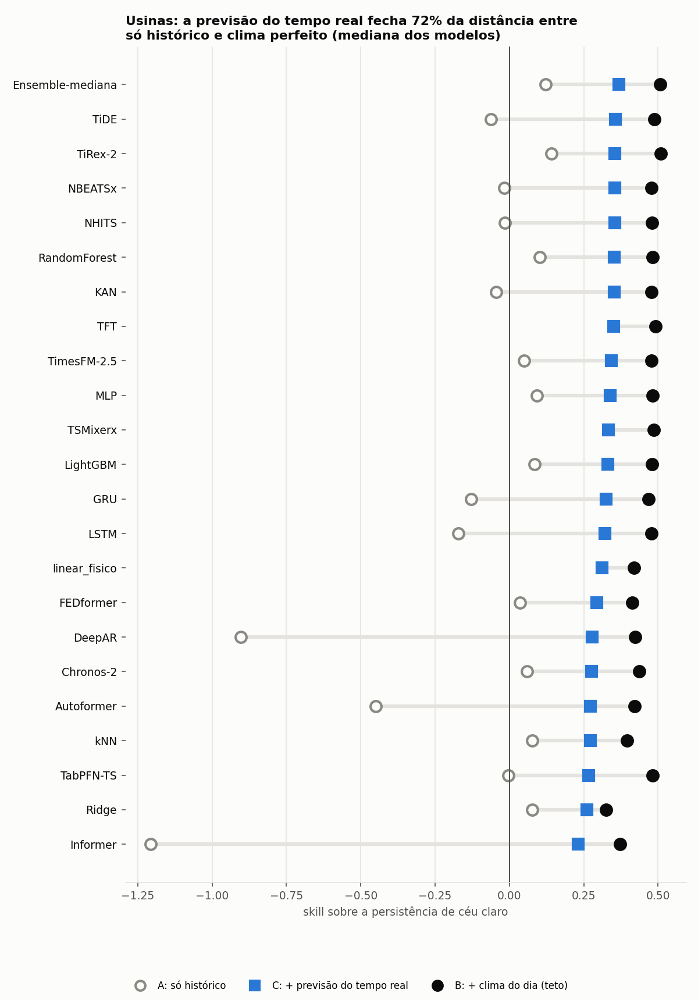
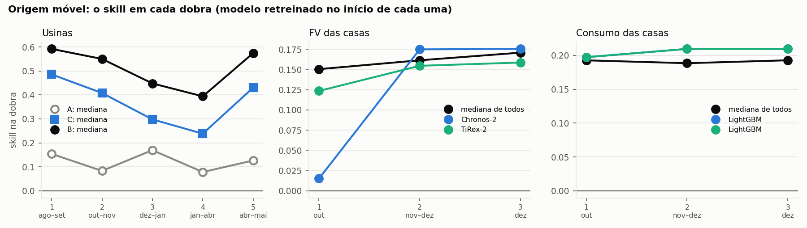

# Testes de modelos de previsão — geração solar e consumo

Primeira rodada (v1) entre 30/09 e 02/10/2026; **protocolo v2** em 05–06/10/2026, a partir do
levantamento de 127 modelos (`../../docs/literatura/Modelos_previsao_geracao_consumo.xlsx`).
**36 modelos e referências, 3 casos, uma tarefa só: prever as 24 horas do dia seguinte, emitindo a
previsão às 00:00.** As redes treinadas rodaram em GPU (RTX 4070); os fundacionais, em CPU.

O que muda da v1 para a v2: **origem móvel** (todo modelo treinado é refeito do zero no início de cada
dobra), **regime C** (a previsão do tempo real da véspera, não o oráculo), **lotes iguais em todas as
redes** e **Diebold–Mariano** com correção de Holm para dizer quem empata com o melhor. A v1 (um corte
único) está guardada em `resultados_v1_corte_unico/`.

## Em cinco linhas

1. **Nas usinas, quem decide é o clima, não o modelo.** Só com o histórico (regime A) o melhor chega a
   +14%; com a previsão real da véspera (regime C), +37%; com o clima do próprio dia (regime B, teto),
   +51%. O vão entre regimes é muito maior que a diferença entre algoritmos — dentro do regime C os 15
   modelos cabem em 0,09 de skill.
2. **A previsão real fecha a maior parte do caminho até o teto:** 62% do vão A→B no LightGBM, 72% na
   mediana dos 12 modelos com os três regimes. E a diferença restante é **qualidade da previsão, não
   treino mais curto**: o diagnóstico B-curto (B com o treino cortado onde o C começa) empata com o B
   (p de Holm 0,08 no LightGBM, 0,07 no linear físico).
3. **ECMWF ganha do GFS.** Trocar o modelo numérico derruba o LightGBM de +0,33 para +0,27
   (C-gfs, p < 0,001). A fonte da previsão importa mais que a escolha do modelo de previsão de série.
4. **Modelos fundacionais sem nenhum treino lideram os três casos.** O melhor ranking médio no regime A
   é do **Toto-2.0-313m** (3,0), e nas casas 8 dos 9 primeiros na geração FV são fundacionais. O
   **TiRex-2** é o melhor modelo individual nas usinas nos três regimes.
5. **A mediana de todos os modelos continua a escolha robusta — mas não é sempre a melhor.** É 1ª nas
   usinas em B e C, 2ª em A e na geração FV das casas, e apenas **9ª de 32** no consumo (ainda assim
   empatada com o melhor). O **SparseTSF, com 32 parâmetros**, empata com o melhor no consumo (7º).

---

## 1. O que foi testado, e por quê

Dos 127 modelos levantados, entraram os que (a) têm código aberto que roda nesta máquina, (b) servem
para as séries que o projeto tem — histórico do medidor, com ou sem clima — e (c) representam uma
família diferente. O **lote 2** (05/10/2026) acrescentou a geração de fundacionais lançada depois da v1.

| Família | Testados | Por quê |
|---|---|---|
| Referências | persistência de ontem, de 7 dias, média de 7 dias, **persistência de céu claro** | sem elas nenhum número significa nada |
| Física | linear sobre `poa_estimada` | o achado central do projeto |
| Árvore | LightGBM global | o mais forte "clássico" e o que o projeto já usa |
| Recorrentes / convolucionais | LSTM, GRU, **ResNet-1D**, TCN | as referências de rede |
| MLP / linear | NHITS, TiDE, DLinear, TSMixerx, N-BEATSx, **SparseTSF (32 parâmetros)** | leves; candidatos ao embarcado |
| Transformer | PatchTST, iTransformer, TFT | os mais citados |
| Kolmogorov-Arnold | KAN | abordagem nova |
| Fundacionais v1 (zero-shot) | Chronos-2, Chronos-Bolt, TimesFM-2.5, TiRex, TTM-r2, Toto, Moirai 2.0 | a maior mudança da área; sem treino |
| **Fundacionais lote 2** | **Toto-2.0 (22m e 313m), TiRex-2, TabPFN-TS, Sundial-128m, Timer-XL-84m, Time-MoE-50M, Moirai-MoE-small** | geração seguinte; TiRex-2 e TabPFN-TS aceitam clima futuro, então rodam em A, B e C |
| Combinação | mediana de todos | regra fixa, sem escolha a posteriori |

**Não testados, e por quê:** imagem de céu e satélite (sem câmera nem série de satélite); previsão do
tempo por IA (produz o clima de entrada, não a geração — é o que entra no regime C); baseados em LLM
(exigem GPU grande, e Tan et al., NeurIPS 2024, mostram que remover o LLM não piora); difusão
(probabilística, fica para quando o foco for incerteza); Mamba e os específicos de FV dos artigos (sem
código aberto pronto); **TimesFM-3** (pesos não comerciais, fora do PyPI); **TimeXer** (a versão do
NeuralForecast não aceita covariáveis futuras, então não usaria a previsão do tempo).

## 2. Dados — só a parte necessária

| Caso | De onde | O que entrou |
|---|---|---|
| **Usinas** (Cascavel 3,96 kWp e Curitiba ~9,6 kWp) | 5 min do inversor + base horária | energia horária; céu claro, GHI, `poa_estimada` e temperatura |
| **FV das casas** | `H*_Wh.csv` | só `Production(Wh)`, somado por hora |
| **Consumo das casas** | `H*_Wh.csv` | só `Consumption(Wh)`, somado por hora |

Tudo cabe em 5 MB: `dados/usinas_horario.parquet`, `casas_horario.parquet`,
`previsao_tempo.parquet` (o arquivo de previsões do regime C) e, desde 07/10/2026,
`clima_casas_horario.parquet` (clima medido das casas, de `scripts/09_clima_casas.py`; abre o regime B
nas casas, ainda não rodado).

**Problemas nos dados (e o que foi feito):**

- **10 das 20 casas não têm FV** (produção zero o ano todo). Ficam fora da geração; entram no consumo.
- **As casas são da comunidade StoreNet, em Dingle, Irlanda** (identificadas em 07/10/2026): Khadem et al.
  (2024), *Scientific Data*, doi:10.1038/s41597-024-03454-2, licença **CC0**. Produção máxima em maio,
  consumo máximo em dezembro. O teste (out–dez) é inverno.
- **O relógio das casas é a hora local de Dublin** (GMT no inverno, UTC+1 no verão), numa grade horária
  sem buraco: o horário da geração FV salta ~1 h em 29/03 nas 10 casas, e o dia de 25 horas do fim do
  horário de verão virou 24 linhas. As linhas de 29/03 01:00 (não existe) e 25/10 01:00 (existiu duas
  vezes) vêm preenchidas. O clima do conjunto está em UTC e é convertido para a hora local antes de juntar.
- **H14 termina em 11/12/2020**, 20 dias antes das outras 19. Isso tem consequência no protocolo:
  ver o defeito de recorte de dobra em §7.
- **Nas usinas o inversor não registra direito à noite nem nas pontas do dia.** Noite vale zero;
  pontas do dia contam o que foi somado se o dia teve registro normal entre 9 h e 15 h.

## 3. Protocolo (v2)

Tudo em `scripts/comum.py`: datas, regimes, dobras, janelas.

- **Tarefa:** 24 valores horários do dia seguinte, emitidos às 00:00, com histórico até 23:00 da
  véspera. Uma janela por dia de teste; nenhum modelo vê o dia que prevê.
- **Teste:** usinas 01/08/2025 → 31/05/2026 (598 dias-usina, 8.940 horas avaliadas); casas 01/10 →
  31/12/2020 (920 dias-casa na geração, 12.880 horas; 1.820 no consumo, 43.680 horas).
- **Origem móvel:** todo modelo treinado é **refeito do zero no início de cada dobra**, só com dados
  anteriores a ela. Usinas: 5 dobras de 61 dias. Casas: 3 dobras de ~31 dias. Fundacionais não treinam.
- **Regimes.** **A:** só o histórico da própria série. **B** (só usinas): + céu claro + clima NASA do
  **próprio dia** — é um **teto**, supõe previsão perfeita. **C** (só usinas): + céu claro + **previsão
  do tempo real emitida na véspera** (ECMWF IFS 0,25°, Open-Meteo Previous Runs), no treino e no teste.
  O arquivo de previsões começa em 06/03/2024, então o treino de C começa em 07/03/2024. **C é o regime
  operacional.** Diagnósticos (só LightGBM e linear físico): **B-curto** = B com o treino cortado onde
  o C começa, para separar o efeito da previsão do efeito do treino mais curto; **C-gfs** = C com o GFS
  no lugar do ECMWF.
- **Treino:** lotes idênticos em todas as redes (168 h de entrada, 500 passos, lote 16, 128 janelas,
  semente 42, 30 dias de validação para parada antecipada); 1.024 h de contexto nos fundacionais.
- **Normalização (regimes B e C):** cada série é padronizada **só com o treino anterior à validação**
  (`comum.normaliza_por_treino`), e a previsão é desnormalizada depois. Não se usa o
  `local_scaler_type` do NeuralForecast, que ajustaria a escala sobre todo o quadro — teste incluído.
  As entradas de B e C em `tempos_redes_*.json` carregam o selo `normalizacao`.
- **Métricas:** nas usinas e na geração das casas, só horas de sol. nMAE, nRMSE e viés normalizados
  pela média real; R²; erro da energia diária; **skill = 1 − RMSE / RMSE da referência** (persistência
  de céu claro nas usinas, "igual a ontem" nas casas), com IC 95% por bootstrap de dias inteiros.
- **Quem empata com o melhor:** Diebold–Mariano por dia (perda quadrática, variância Newey–West,
  correção Harvey–Leybourne–Newbold) contra o melhor do mesmo caso e regime, com **Holm** na família.
  "Empatado" = p de Holm ≥ 0,05. Uma não rejeição não prova equivalência, e o melhor foi escolhido
  neste mesmo teste — é um filtro de leitura, não um teste de superioridade.

Saídas: `resultados/metricas.csv`, `metricas_por_dobra.csv`, `metricas_por_serie.csv`,
`dm_vs_melhor.csv`, `dm_regimes.csv`.

## 4. Resultados

### Usinas — os três regimes

| | Regime A (só histórico) | skill [IC 95%] | | Regime C (previsão real) | skill | | Regime B (clima do dia, teto) | skill |
|---|---|---|---|---|---|---|---|---|
| 1 | **TiRex-2** | **+0,141** [0,100; 0,173] | | **Mediana de todos** | **+0,372** | | **Mediana de todos** | **+0,515** |
| 2 | Mediana de todos ∘ | +0,125 | | TiDE | +0,356 | | TiRex-2 ∘ | +0,509 |
| 3 | Toto-2.0-313m ∘ | +0,120 | | TiRex-2 | +0,355 | | TFT | +0,491 |
| 4 | ResNet-1D ∘ | +0,116 | | N-BEATSx | +0,354 | | TiDE | +0,487 |
| 5 | Toto-2.0-22m | +0,095 | | NHITS | +0,354 | | TSMixerx | +0,485 |
| 6 | Chronos-Bolt-small | +0,092 | | KAN | +0,352 | | TabPFN-TS | +0,481 |
| 7 | TTM-r2 | +0,092 | | TFT | +0,351 | | LightGBM | +0,480 |
| 8 | LightGBM | +0,084 | | TimesFM-2.5 | +0,344 | | NHITS | +0,479 |

∘ = empata com o melhor (Holm ≥ 0,05). **Em A, 3 de 33 empatam com o TiRex-2; em B, 1 de 15; em C,
nenhum** — a mediana é a melhor do regime operacional de forma estatisticamente distinguível.

**A escada do LightGBM** (o mesmo modelo nos cinco regimes, para isolar o efeito da entrada):

| Regime | skill | o que é |
|---|---|---|
| A | +0,084 | só histórico |
| C-gfs | +0,274 | previsão real, GFS |
| **C** | **+0,330** | previsão real, ECMWF — **o regime operacional** |
| B-curto | +0,469 | clima do dia, treino curto como o do C |
| B | +0,480 | clima do dia, treino inteiro (teto) |

- **O C fecha 62% do vão A→B** no LightGBM e **72%** na mediana dos 12 modelos que têm os três regimes.
- **O que falta é qualidade de previsão, não treino.** B-curto × B não é significativo (p de Holm 0,081
  no LightGBM, 0,070 no linear físico). Já B-curto × C é (p < 0,001): o treino curto não explica o vão.
- **ECMWF > GFS:** C-gfs × C significativo (p < 0,001) nos dois modelos.
- **C × A e C × B são significativos em todas as comparações** (13/13 e 15/15). A ordem A < C < B vale
  para todo modelo e em todas as 5 dobras.

No dia nublado os modelos de regime A preveem um dia normal; só quem recebeu clima acompanha a queda.

### Geração FV das 10 casas (inverno, sem clima)

| | Modelo | skill [IC 95%] |
|---|---|---|
| 1 | **Toto-2.0-313m** | **+0,178** [0,161; 0,196] |
| 2 | Mediana de todos ∘ | +0,161 |
| 3 | Timer-XL-84m ∘ | +0,158 |
| 4 | Toto-2.0-22m ∘ | +0,149 |
| 5 | TiRex-2 ∘ | +0,145 |
| 6 | Toto ∘ | +0,126 |
| 7 | TTM-r2 ∘ | +0,119 |
| 8 | Chronos-2 ∘ | +0,118 |

**21 dos 32 empatam com o melhor** — o caso quase não separa modelos. Os ganhos são pequenos (o melhor
+18% sobre "igual a ontem"): a geração de uma casa isolada é pouco previsível sem clima nem localização.

### Consumo das 20 casas

| | Modelo | skill [IC 95%] |
|---|---|---|
| 1 | **LightGBM** | **+0,206** [0,190; 0,222] |
| 2 | Time-MoE-50M ∘ | +0,203 |
| 3 | Timer-XL-84m ∘ | +0,202 |
| 4 | Sundial-128m ∘ | +0,201 |
| 5 | Toto-2.0-313m ∘ | +0,192 |
| 6 | Chronos-Bolt-small ∘ | +0,191 |
| 7 | **SparseTSF (32 parâmetros)** ∘ | +0,191 |
| 9 | Mediana de todos ∘ | +0,191 |

**9 dos 32 empatam com o melhor**, e o SparseTSF com **32 parâmetros** é um deles. A mediana cai para
**9º** — robusta, mas não melhor que os melhores individuais. (Na v1 ela era 5ª; o lote 2 acrescentou
8 modelos fortes neste caso.)

### Leitura transversal (regime A, os três casos)

| Modelo | Usinas | FV casas | Consumo | Ranking médio |
|---|---|---|---|---|
| **Toto-2.0-313m** | +0,120 | +0,178 | +0,192 | **3,0** |
| Mediana de todos | +0,125 | +0,161 | +0,191 | 4,3 |
| TiRex-2 | +0,141 | +0,145 | +0,179 | 6,3 |
| Toto-2.0-22m | +0,095 | +0,149 | +0,183 | 6,7 |
| Timer-XL-84m | +0,056 | +0,158 | +0,202 | 6,7 |
| TTM-r2 | +0,092 | +0,119 | +0,191 | 7,3 |
| LightGBM | +0,084 | +0,074 | +0,206 | 10,0 |

O TTM-r2 era o mais consistente na v1 (3 M parâmetros, segundos em CPU); o lote 2 passou à frente dele,
mas ele continua o melhor custo-benefício para embarcado entre os fundacionais.

A figura por dobra é a justificativa da origem móvel: o nível de skill oscila bastante entre dobras
(nas usinas o regime B vai de ~0,40 a ~0,61), mas a ordem B > C > A não se inverte em nenhuma. Nas
casas o **ranking entre modelos troca** de dobra para dobra — um corte único escolheria outro vencedor.

## 5. Melhorias recomendadas, em ordem de ganho esperado

1. **Melhorar a previsão do tempo, não o modelo de série.** O C já fecha 62–72% do vão, e o que resta é
   qualidade de previsão (B-curto × B empata). Caminhos: ensemble de NWP, mais rodadas por dia, ou a
   previsão por IA (Aurora, GraphCast, WeatherNext) no lugar do IFS determinístico.
2. **Usar o regime C como padrão de relato.** O B é teto e não existe às 00:00; o A subestima o que o
   sistema consegue. Todo número operacional deve ser do C.
3. **Mediana de vários modelos em vez de escolher um** — 1ª em B e C, nunca abaixo de 9ª, e não exige
   saber de antemão qual modelo serve para a usina nova.
4. **Para o embarcado: TTM-r2 e SparseTSF.** O SparseTSF empata com o melhor no consumo com 32
   parâmetros. Falta medir latência e energia no Raspberry Pi 5 / ESP32 — hoje só há medida em x86, que
   é overhead de chamada Python, não custo de rede.
5. **Corrigir o viés dos fundacionais no consumo** (~−20%): média em vez de mediana, ou correção
   aprendida nos últimos 30 dias.
6. **Geração das casas: obter a localização** e acrescentar céu claro. Dá para estimar latitude e
   longitude pelo próprio perfil diário (nascer, pôr e meio-dia solar).
7. **Evitar:** LSTM/GRU só com histórico nas usinas (perdem da persistência de céu claro);
   iTransformer para séries independentes; `local_scaler_type` do NeuralForecast com covariáveis
   (ajusta a escala sobre o teste também — ver §3 e §7).

## 6. O que não foi testado e deveria ser

- Ajuste fino do TTM e do Chronos-2 nos dados de cada usina. **Bloqueado:** o `granite-tsfm` instala
  incompleto nesta máquina (sem `tsfm_public.toolkit`) — ver `ambientes/LEIA-ME.md`.
- Previsão probabilística (quantis) com avaliação por CRPS. Vários modelos já entregam quantis; o
  `05_avalia.py` só avalia o ponto.
- Regime C nas casas (precisa da localização) e um segundo ano de teste nas usinas.
- Latência e energia no alvo embarcado real.

## 7. Limitações e o que aconteceu no caminho

Seis defeitos encontrados e corrigidos entre 05 e 06/10/2026, dois deles com efeito nos números:

- **Recorte de dobra (vazamento no `casas_cons`).** O `para_janelas` guardava todas as janelas do
  `cross_validation`, e como o NeuralForecast conta as `n_windows` a partir do fim de **cada** série, a
  H14 (que acaba 20 dias antes das outras) recuava e reemitia 20 dias de uma dobra anterior — com o
  modelo da dobra seguinte, treinado com dados posteriores a eles. Também duplicava 480 linhas por
  modelo e quebrava o `05_avalia`. Atingia as 9 redes do `casas_cons`, que foram refeitas; `usinas` e
  `casas_prod` têm todas as séries terminando no mesmo dia e não mudaram. Nenhum número publicado antes
  dependia disso (o `metricas.csv` exportado do Lactec não tinha redes no `casas_cons`).
- **TiDE não usava o clima.** O `MLPResidual` do TiDE termina num LayerNorm sobre `temporal_width` (4 =
  o número de exógenas), aplicado em **cada hora**: isso tira média e escala das 4 variáveis de clima
  hora a hora, ou seja, apaga a amplitude — exatamente o sinal de "quanto sol faz". O TiDE ficava em
  skill +0,07 em B e C, contra +0,47 a +0,49 dos pares, nas duas versões (v1 e v2). Com
  `layernorm=False` vai a **+0,487 (B)** e **+0,356 (C)**, e passa a responder ao clima como os outros
  (medido na dobra 1: nRMSE 0,59 → 0,28; `temporal_width` maior não resolve, só o layernorm). Antes da
  correção o TiDE era a única exceção no teste C × B; agora as 15 comparações são significativas.
- **Normalização ajustada sobre o teste.** O `local_scaler_type="standard"` do NeuralForecast ajusta a
  escala sobre todo o quadro passado ao `cross_validation`, teste incluído. Substituído por
  `comum.normaliza_por_treino` (só o treino anterior à validação), com teste de regressão em
  `scripts/test_auditoria.py`. As 16 entradas de B e C foram refeitas. **O efeito nos números foi
  pequeno** (LightGBM C de +0,3305 para +0,3298), mas o procedimento anterior não era defensável.
- **Famílias nas figuras.** Os 8 modelos do lote 2 não estavam em `FAMILIA` e apareciam como "rede
  treinada" nas figuras — justamente a comparação do achado "fundacionais empatam com as treinadas".
- **Exclusão silenciosa na figura de regimes.** O filtro da figura tira quem está em `FAMILIA`, com
  quatro exceções nomeadas; ao classificar o lote 2 corretamente, o TiRex-2 e o TabPFN-TS saíram da
  figura — e eram justamente os dois que fecham menos vão (57,9% e 55,9%), o que inflava a mediana do
  título em cerca de 3 pontos. Os dois voltaram à lista de exceções.
- **Memória do Time-MoE-50M.** Um lote de 32 com contexto de 1.024 h leva a RAM de 0,7 para 13,1 GB e
  derruba a rodada; passou a lote 8. Não muda a previsão (cada janela é independente).

Outras limitações:

- **Duas versoes de torch nas redes treinadas (08/10/2026).** As 52 entradas originais treinaram com
  `torch 2.11.0+cu128`. No dia 08/10 a politica de Controle de Aplicativo do Windows passou a bloquear
  o `torch/lib/shm.dll` desse ambiente (`WinError 4551`), de forma persistente: nao e o bloqueio
  transitorio de primeiro acesso, e reescrever o arquivo nao resolve (a decisao e pelo conteudo). O
  mesmo torch funciona nos ambientes `lote2`, `lote2_hf` e `moirai`, e o Smart App Control nao mudou de
  estado — era bloqueio de um arquivo, nao de politica. O `previsao` foi atualizado para
  `torch 2.14.1+cu130` (a versao que ja rodava no `lote2`), e por isso **as redes do passo T treinaram
  com 2.14.1 e as 52 originais com 2.11.0**. E um confundimento de versao menor que o de CPU x GPU, mas
  precisa ser dito ao comparar as duas gerações de redes. A alternativa seria desligar o Smart App
  Control, que no Windows e irreversivel; nao foi feito porque havia alternativa funcionando.
- **AutoARIMA com configuracao propria.** Com os padroes do StatsForecast
  (`approximation=False`, `nmodels=94`) o AutoARIMA levou **54.554 s = 15,2 h** so em `usinas|A`, com
  duas series: faz selecao de ordem por maxima verossimilhanca em 94 candidatos sobre uma serie horaria
  de ~60 mil pontos, uma vez por dobra. Os outros seis casos seriam dias de maquina. Passou a rodar com
  `approximation=True`, `stepwise=True`, `max_p=3`, `max_q=3`, `max_P=1`, `max_Q=1` e `nmodels=24`. A
  ordem escolhida pode diferir da que o padrao escolheria; a configuracao usada fica gravada em cada
  entrada de `resultados/tempos_classicos.json`, no campo `config`. Os outros tres classicos
  estatisticos (AutoETS, AutoTheta, MSTL) rodam com o padrao — o AutoETS leva 146 s no mesmo caso.
- **Regime B é um teto**, não uma previsão operacional; o número operacional é o do C.
- **Regime C começa em 07/03/2024** (início do arquivo de previsões), então treina com menos história
  que A e B. O diagnóstico B-curto existe para medir esse efeito — e mostra que ele é pequeno.
- **As três referências ingênuas são avaliadas em menos horas** que os outros 30 modelos em `usinas|A`
  (8.800 a 8.933 contra 8.940): elas não têm previsão para os primeiros dias do teste. Os 30 modelos de
  interesse estão todos no mesmo denominador.
- **Dispositivo:** as 52 entradas de rede treinada rodaram em GPU (`dispositivo` em
  `tempos_redes_*.json`). O SparseTSF e o ResNet-1D são implementações próprias e seguem o
  `DISPOSITIVO`. GPU e CPU podem mudar o último dígito; os fundacionais rodaram em CPU.
- **As casas são de outro país**, sem localização, e o teste é um único inverno.
- **`pot_nominal_kWp` de Curitiba é estimada** (~9,6 kWp): todo número por kWp é provisório.

## 8. Como reproduzir

Quatro ambientes, descritos em `ambientes/LEIA-ME.md` (leia os desvios de instalação — sem eles a
montagem falha ou deixa o ambiente errado em silêncio). Rodar de `scripts/`:

    set DISPOSITIVO=cuda        # PowerShell: $env:DISPOSITIVO="cuda"; bash: export DISPOSITIVO=cuda

    python 01_prepara_dados.py        # dados horarios (NAO roda aqui: a base de 5 min ficou no Lactec)
    python 02_referencias.py          # referencias, linear fisico, LightGBM (todos os regimes)
    python 03_fundacionais.py         # fundacionais v1
    <moirai>/python 03b_moirai.py     # Moirai 2.0
    python roda_v2.py                 # redes treinadas, usinas e casas em dois processos
    python roda_lote2.py              # lote 2 + ensemble + metricas + figuras
    python -m unittest discover -s . -p test_auditoria.py   # regressoes do protocolo

Modelos já concluídos são pulados (`resultados/tempos_*.json`), então basta reiniciar as filas. Para
refazer um modelo, apague a entrada dele do `tempos_*.json` correspondente. O `04_redes_treinadas.py`
aceita `--modelos` e `--regimes` para rodar um subconjunto.
