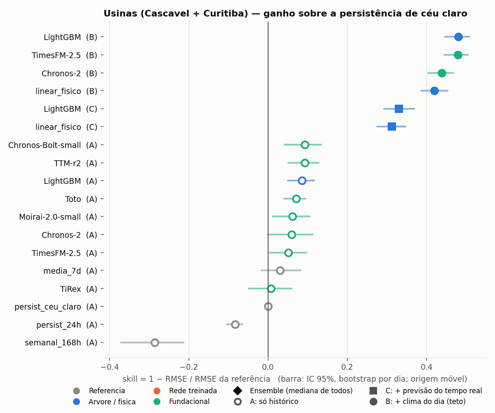
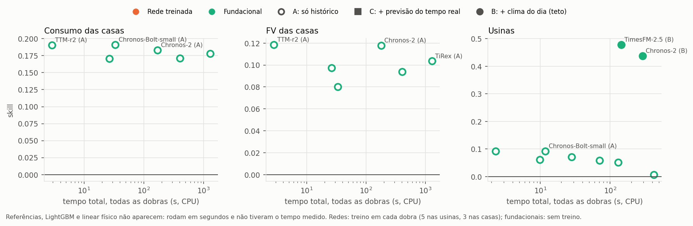

# Testes de modelos de previsão — geração solar e consumo

Feitos entre 30/09 e 02/10/2026, a partir do levantamento de 127 modelos
(`../revisao_edge_ai/Modelos_previsao_geracao_consumo.xlsx`). **33 modelos e
referências, 3 casos, uma tarefa só: prever as 24 horas do dia seguinte, emitindo
a previsão às 00:00.** Tudo roda em CPU, nesta máquina.

## Em cinco linhas

1. **Nas usinas, quem decide é o clima, não o modelo.** Com o clima do dia dado
   (regime B, teto), 8 modelos empatam em +47% a +51% sobre a persistência de céu
   claro; só com o histórico (regime A), o melhor chega a +11%. O vão entre os
   regimes (~0,40) é dez vezes a diferença entre os algoritmos (~0,03).
2. **Um modelo linear com uma variável física (`poa_estimada`) já leva +42%** dos
   ~+50% possíveis — o mesmo achado do `ESTADO_DO_PROJETO.md`, agora na previsão.
3. **Modelos fundacionais sem nenhum treino empatam com os treinados.** O mais
   consistente nos três casos é o **TTM** (IBM, 3 milhões de parâmetros, roda em
   CPU em segundos): ranking médio 3,3, sempre entre os primeiros.
4. **A mediana de todos os modelos (sem escolher nenhum) é o resultado mais robusto:**
   1º nas usinas (A e B), 2º na geração das casas, entre os primeiros no consumo.
5. **Para o embarcado, o SparseTSF com 32 parâmetros** empata com os melhores no
   consumo das casas (+19%). LSTM e GRU só com histórico perdem da persistência de
   céu claro nas usinas.

---

## 1. O que foi testado, e por quê (minha leitura do levantamento)

Dos 127 modelos levantados, testei os que (a) têm código aberto que roda em CPU,
(b) servem para as séries que o projeto tem — histórico do medidor, com ou sem
clima — e (c) representam uma família diferente:

| Família | Testados | Por quê |
|---|---|---|
| Referências | persistência de ontem, de 7 dias, média de 7 dias, **persistência de céu claro** | sem elas nenhum número significa nada |
| Física | linear sobre `poa_estimada` | o achado central do projeto |
| Árvore | LightGBM global | o mais forte "clássico" e o que o projeto já usa |
| Recorrentes / convolucionais | **LSTM, GRU, ResNet-1D** (os que você citou), TCN | as referências de rede |
| MLP / linear | NHITS, TiDE, DLinear, TSMixerx, **SparseTSF (32 parâmetros)** | leves; candidatos ao embarcado |
| Transformer | PatchTST, iTransformer, TFT | os mais citados |
| Kolmogorov-Arnold | KAN | abordagem nova |
| Fundacionais (zero-shot) | **Chronos-2, Chronos-Bolt, TimesFM-2.5, TiRex, TTM, Toto, Moirai 2.0** | a maior mudança da área; sem treino |
| Combinação | mediana de todos | regra fixa, sem escolha a posteriori |

**Não testados, e por quê:**

| Família | Motivo |
|---|---|
| Imagem de céu e satélite (SolarSeer, SkyEvo, STARGPT, PVNet) | não há câmera de céu nem série de satélite no projeto |
| Previsão do tempo por IA (Aurora, GraphCast, WeatherNext 3) | produzem o **clima de entrada**, não a geração; entram no lugar da NASA, ver §6 |
| Baseados em LLM (Time-LLM, GPT4TS, LLMTime, os de FV com LLM) | exigem LLM grande e GPU; e Tan et al. (NeurIPS 2024, "Are Language Models Actually Useful for Time Series Forecasting?") mostram que remover o LLM desses modelos não piora o resultado |
| Difusão (TimeGrad, CSDI, PV-MM-diffusion) | previsão probabilística, pesada em CPU; fica para quando o foco for incerteza |
| xLSTM via NeuralForecast | precisa de kernels compilados para GPU; a família está representada pelo **TiRex** (fundacional baseado em xLSTM) |
| TimesFM-3 | os pesos são só para uso não comercial e não estão no pacote do PyPI |
| Mamba e os específicos de FV/consumo dos artigos | sem código aberto pronto para estas séries |

## 2. Dados — só a parte necessária

| Caso | De onde | O que entrou |
|---|---|---|
| **Usinas** (Cascavel 3,96 kWp e Curitiba ~9,6 kWp) | `ia_solar/analise/*/dados/` (5 min do inversor) + `ia_solar/base_modelagem/*/base_*_horaria.parquet` | energia horária; céu claro, GHI, `poa_estimada` e temperatura da NASA (já com o −55 min) |
| **FV das casas** | `dados_casas/H*_Wh.csv` | só `Production(Wh)`, somado por hora |
| **Consumo das casas** | `dados_casas/H*_Wh.csv` (= `dados_casas/consumption_all_houses.csv`) | só `Consumption(Wh)`, somado por hora |

Bateria, rede, estado de carga e os arquivos `_W` não foram usados. Tudo cabe em
5 MB: `testes_modelos/dados/usinas_horario.parquet` e `casas_horario.parquet`.

**Problemas encontrados nos dados (e o que foi feito):**

- **10 das 20 casas não têm FV** (produção zero o ano todo: H6, H8, H9, H12, H14,
  H15, H16, H18, H19, H20). Ficaram fora do caso de geração; entram no consumo.
- **As casas são do hemisfério norte**, quase certamente Europa: produção máxima em
  maio, mínima em dezembro, consumo máximo em dezembro, e um dia de 25 horas no fim
  do horário de verão. O teste (out–dez) é inverno com pouco sol.
- **H14 termina em 11/12/2020**; H4 tem 60% do arquivo `_W` corrompido (o `_Wh`,
  que foi o usado, está 99,99% completo).
- **Nas usinas, o inversor não registra direito à noite nem nas pontas do dia.**
  Noite vale zero; pontas do dia (céu claro < 150 W/m²) contam o que foi somado se
  o dia teve registro normal entre 9 h e 15 h. A energia anual não mudou (5.762 kWh
  em Cascavel), o que confirma que a regra só completa horas quase nulas.

## 3. Protocolo

- **Tarefa:** 24 valores horários do dia seguinte, emitidos às 00:00, com histórico
  até 23:00 da véspera. Uma janela por dia de teste; nenhum modelo vê o dia que prevê.
- **Teste:** usinas 01/08/2025 → 31/05/2026 (fim da NASA horária; 598 dias-usina);
  casas 01/10 → 31/12/2020 (920 dias-casa na geração, 1.820 no consumo).
- **Regime A:** só o histórico da própria série. **Regime B (só usinas):** + céu
  claro + clima NASA do próprio dia. B é um **teto**: supõe previsão do tempo
  perfeita; uma previsão real fica entre A e B.
- **Treino:** tudo antes do teste; últimos 30 dias como validação para parada
  antecipada; entrada de 168 h (redes) ou 1.024 h (fundacionais); semente 42;
  um modelo global por caso. Fundacionais: nenhum treino.
- **Métricas:** nas usinas e na geração das casas, só horas de sol. nMAE, nRMSE e
  viés normalizados pela média real; R²; erro da energia diária; **skill = 1 − RMSE
  / RMSE da referência** (persistência de céu claro nas usinas, "igual a ontem" nas
  casas), com IC 95% por bootstrap de dias inteiros.

## 4. Resultados

Tabela completa: `resultados/metricas.csv` (e `metricas_por_serie.csv`).

### Usinas

| | Regime B (clima do dia) | skill [IC 95%] | R² | | Regime A (só histórico) | skill [IC 95%] |
|---|---|---|---|---|---|---|
| 1 | **Mediana de todos** | **+0,51** [0,47; 0,53] | 0,913 | | **Mediana de todos** | **+0,11** [0,08; 0,14] |
| 2 | TFT | +0,50 [0,46; 0,53] | 0,910 | | ResNet-1D | +0,10 [0,07; 0,13] |
| 3 | TSMixerx | +0,49 | 0,906 | | Chronos-Bolt-small | +0,09 |
| 4 | LSTM | +0,48 | 0,905 | | TTM-r2 | +0,09 |
| 5 | NHITS / LightGBM / TimesFM-2.5 | +0,48 | 0,90 | | LightGBM | +0,09 |
| | Chronos-2 | +0,44 | 0,888 | | Toto | +0,07 |
| | **Linear físico (1 variável)** | **+0,42** | 0,880 | | LSTM / GRU | **−0,14 / −0,13** |
| | TiDE | +0,08 | 0,696 | | iTransformer | −0,80 |

- **R² horário 0,90–0,91 no regime B.** O 0,80–0,82 do `ESTADO_DO_PROJETO.md` é
  em 5 minutos e no mesmo instante; na hora a série é mais lisa. Não são comparáveis
  diretamente.
- **TFT e TimesFM-2.5 com covariáveis empatam com o LightGBM** — o TimesFM sem treino
  nenhum, só regressão linear nas covariáveis + o modelo no resíduo.
- O iTransformer trata as duas usinas como variáveis de um mesmo sistema e mistura
  as duas: não serve para séries independentes.

No dia nublado só o TFT (B), que recebeu o clima do dia, acompanha a queda; os
modelos de regime A preveem um dia normal. É a diferença entre A e B numa imagem.

### Geração FV das 10 casas (inverno, sem clima)

| | Modelo | skill [IC 95%] |
|---|---|---|
| 1 | KAN | **+0,17** [0,15; 0,19] |
| 2 | Mediana de todos | +0,16 |
| 3 | TCN | +0,15 |
| 4 | NHITS | +0,14 |
| 5 | TTM-r2 / Chronos-2 | +0,12 |
| | LightGBM | +0,06 — viés de **+40%** |
| | LSTM | −0,11 |

O LightGBM aprendeu o verão (treino de janeiro a setembro) e superestima o inverno.
As redes pequenas, que normalizam cada janela, se adaptam ao nível recente.

### Consumo das 20 casas

| | Modelo | skill [IC 95%] | viés |
|---|---|---|---|
| 1 | LightGBM | **+0,20** [0,18; 0,22] | 0% |
| 2 | Chronos-Bolt-small | +0,19 | **−18%** |
| 3 | TTM-r2 | +0,19 | −2% |
| 4 | **SparseTSF (32 parâmetros)** | +0,19 | −1% |
| 5 | Mediana de todos | +0,19 | −20% |
| | Chronos-2 / TiRex / TimesFM / Moirai | +0,17 a +0,18 | −21 a −23% |

Empate estatístico entre os quatro primeiros. **Os fundacionais subestimam o
consumo em ~20%**: preveem a mediana, e o consumo é assimétrico (picos curtos e
altos). Para balanço de energia, o viés pesa mais que o erro horário.

### Leitura transversal (regime A, os três casos)

| Modelo | Usinas | FV casas | Consumo | Ranking médio | Parâmetros |
|---|---|---|---|---|---|
| **TTM-r2** | +0,09 | +0,12 | +0,19 | **3,3** | 3,0 M |
| Chronos-Bolt-small | +0,09 | +0,08 | +0,19 | 5,0 | 48 M |
| Chronos-2 | +0,06 | +0,12 | +0,18 | 5,7 | 120 M |
| LightGBM | +0,09 | +0,06 | +0,20 | 6,0 | — |
| KAN | +0,05 | +0,17 | +0,16 | 7,3 | 1,0 M |
| SparseTSF | +0,05 | +0,02 | +0,19 | 9,7 | **32** |
| ResNet-1D | +0,10 | +0,07 | +0,06 | 10,3 | 0,1 M |
| LSTM | −0,14 | −0,11 | +0,14 | 18,3 | 0,2 M |

## 5. Melhorias recomendadas nos modelos

Em ordem de ganho esperado:

1. **Trocar a fonte de clima, não o modelo.** O vão A→B (~0,40) é o que importa.
   Testar previsão do tempo real (não o oráculo NASA): CAMS (satélite, `pvlib.iotools.get_cams`),
   ERA5, ou a previsão numérica do Open-Meteo. O regime B é o teto; o objetivo é
   chegar perto dele com uma previsão que exista às 00:00.
2. **Modelo híbrido física + resíduo como padrão.** O linear sobre `poa_estimada` dá
   +0,42; o TimesFM-2.5 no modo "regressão + modelo no resíduo" chega a +0,48 sem
   treino. É interpretável, barato e não depende de retreino.
3. **Mediana de vários modelos em vez de escolher um.** Nunca ficou abaixo do 2º
   lugar; é a escolha segura para uma usina nova, quando não se sabe qual modelo
   vai funcionar.
4. **Para o embarcado: TTM e SparseTSF.** TTM é o mais consistente sem treino
   (3 M parâmetros); SparseTSF empata com os melhores no consumo com 32 parâmetros.
   Próximo passo: medir latência e energia no Raspberry Pi / ESP32 (hoje só x86).
5. **Corrigir o viés dos fundacionais no consumo** (−20%): usar a média em vez da
   mediana, ou uma correção de viés aprendida nos últimos 30 dias.
6. **Geração das casas: obter a localização** e acrescentar o céu claro. Sem ela, o
   LightGBM não tem como saber que é inverno. Dá para estimar latitude e longitude
   pelo próprio perfil diário de produção (nascer, pôr e meio-dia solar).
7. **Evitar:** LSTM/GRU só com histórico nas usinas (perdem da persistência de céu
   claro); iTransformer para séries independentes; normalização por janela com
   covariáveis (ver §7).

## 6. O que não foi testado e deveria ser

- Previsão do tempo real (item 1 acima) — o experimento de maior valor.
- Ajuste fino (*fine-tuning*) do TTM e do Chronos-2 nos dados de cada usina.
- Previsão probabilística (quantis) com avaliação por CRPS.
- Origem móvel (vários cortes de teste) e teste de Diebold–Mariano entre os empatados.

## 7. Limitações e o que aconteceu no caminho

- **Defeito corrigido no regime B.** Na primeira rodada, GRU, LSTM, NHITS e KAN com
  clima explodiram (até 2.400 kWh/h numa usina de 4 kW). A normalização por janela
  do NeuralForecast dividia o clima futuro por uma escala da semana anterior; depois
  de uma semana nublada, um dia de sol virava um valor enorme. Corrigido com
  normalização global por série; os 7 modelos foram retreinados. A versão com defeito
  está guardada em `resultados/metricas_antes_da_correcao_B.csv`. O TiDE (B) continua
  fraco (+0,08) mesmo depois da correção — não investigado.
- **Lotes diferentes.** As 9 redes do regime A nas usinas usaram lotes padrão (32 séries,
  1.024 janelas); as demais, lotes menores (16 e 128) por falta de memória.
- **Toto só nas usinas.** O PatchTST também só nas usinas (o mais lento).
- **Um corte de teste por caso**, sem origem móvel.
- **Regime B é um teto**, não uma previsão operacional.
- **As casas são de outro país** e o teste é um único inverno.

## 8. Como reproduzir

Ambiente separado, fora do OneDrive: `C:\Users\L08741\.venvs\previsao` (Python 3.12,
torch CPU) e `C:\Users\L08741\.venvs\moirai` (só para o Moirai, que exige torch antigo).

    python scripts/01_prepara_dados.py        # dados horarios (python global)
    python scripts/02_referencias.py          # referencias, fisico, LightGBM
    python scripts/03_fundacionais.py         # 6 fundacionais; Toto: "Toto --casos usinas"
    .venvs/moirai/.../python scripts/03b_moirai.py
    python scripts/04_redes_treinadas.py      # redes; pula as que ja estao em tempos_redes.json
    python scripts/07_ensemble.py             # mediana de todos
    python scripts/05_avalia.py               # metricas e IC
    python scripts/06_figuras.py              # figuras

O protocolo está todo em `scripts/comum.py`: datas, regimes, janelas.
